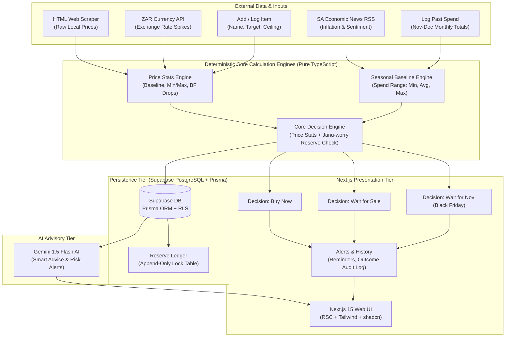
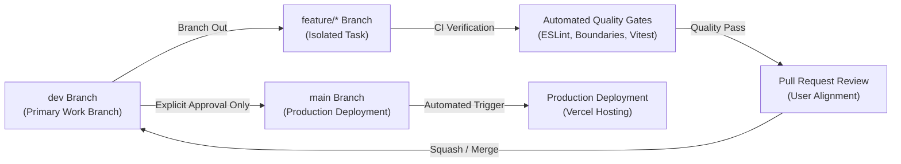
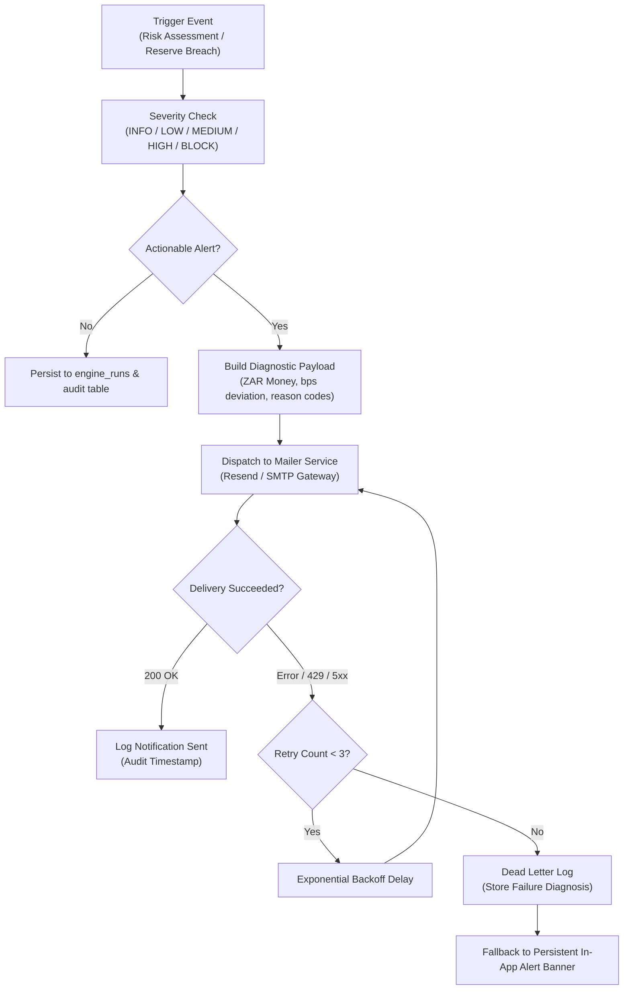

# 🛡️ Buffer Guard (Janu-worry MVP) — Persistent Task Memory & Living Blueprint

> [!NOTE]
> **Living Context Document:** This document serves as the persistent long-term memory for Buffer Guard. It must be consulted at the beginning of every session and maintained at the conclusion of every turn. It preserves architectural integrity, tracking state, active issues, and Git lifecycle disciplines across development boundaries.

---

## 1. Project Header

| Metadata Field | Specification / Value |
| :--- | :--- |
| **Project Name** | **Buffer Guard** (Internal Codename: *Janu-worry MVP*) |
| **Client / Business** | Consumer FinTech / Personal Budget & Retail Defense System |
| **Target Region & Currency** | South Africa (`ZAR` - Integer Cents `BIGINT`), Timezone: `Africa/Johannesburg` |
| **Framework & Version** | **Next.js 15.1.0** (App Router, React 19, Server Components & Server Actions) |
| **Language & Tooling** | **TypeScript 5.7+** (Strict mode, `noUncheckedIndexedAccess`, zero `any`, verbatim imports) |
| **Styling & UI Kit** | **Tailwind CSS 3.4+**, **shadcn/ui** primitives, Lucide Icons |
| **Database & ORM** | **Supabase PostgreSQL** via **Prisma ORM 6.0+** (Connection pooler for runtime, direct URL for migrations) |
| **Authentication & Security** | **Supabase Auth** (`@supabase/ssr`), Row Level Security (RLS) policies as defense-in-depth |
| **AI Decision Assistance** | **Google Gemini 1.5 Flash API** (Structured Context Window, advisory heuristics) |
| **Testing & Verification** | **Vitest** (Unit/Engine property testing), **Playwright** (E2E golden paths) |
| **Workspace / Repo Path** | `c:\dev\buffer-guard` |
| **Last Updated Date** | **22 November 2026** (Session 01) |

### Active Git Workflow Rules
> [!IMPORTANT]
> 1. **Default Working Branch:** All active coding happens on branch `dev` or dedicated `feature/<name>` branches.
> 2. **Main Protection:** Never commit directly to `main`. `main` only receives verified merges from `dev`.
> 3. **Push Policy:** Only push to remote repositories when explicitly instructed by the user.
> 4. **Pre-Commit Verification:** Linting (`eslint-plugin-boundaries`), type checking (`tsc --noEmit`), and engine unit tests must pass cleanly before merge.

---

## 2. Architecture Snapshot

```
c:\dev\buffer-guard\
├─ .git/                                # Git repository tracking (Active branch: dev)
├─ docs/                                # Strategic planning and design specifications
│  ├─ ARCHITECTURE_BLUEPRINT.md         # Full architecture blueprint & data dictionary        [✅ healthy]
│  ├─ decision-engine-flow.jpg          # Dual-track price and budget flow diagram             [✅ healthy]
│  └─ system-dataflow.png               # High-level scrapers-to-Gemini data flow diagram      [✅ healthy]
├─ prisma/                              # Database layer
│  ├─ schema.prisma                     # Prisma schema definitions (Drafted in blueprint)     [🔲 planned]
│  ├─ migrations/                       # DDL and custom RLS SQL migrations                   [🔲 planned]
│  └─ seed.ts                           # Black Friday promo windows & test fixtures           [🔲 planned]
├─ supabase/                            # Supabase local environment & policies
│  ├─ config.toml                       # Supabase local studio & auth config                  [🔲 planned]
│  └─ policies/                         # RLS policies applied via custom migration            [🔲 planned]
├─ tests/                               # Test suites
│  ├─ fixtures/                         # Frozen 5-year historical pricing datasets            [🔲 planned]
│  ├─ integration/                      # Repository queries with RLS testing                  [🔲 planned]
│  └─ e2e/                              # Playwright end-to-end critical user journeys         [🔲 planned]
├─ src/                                 # Application source tree
│  ├─ app/                              # Next.js App Router (RSC & API endpoints)             [🔲 planned]
│  │  ├─ (auth)/login/page.tsx          # Supabase authentication interface                   [🔲 planned]
│  │  ├─ (app)/                         # Authenticated application shell
│  │  │  ├─ layout.tsx                  # Session guard and UI-state context provider         [🔲 planned]
│  │  │  ├─ dashboard/page.tsx          # Primary dashboard & reserve status                  [🔲 planned]
│  │  │  ├─ items/[itemId]/page.tsx     # Item detail & historical price drop curve            [🔲 planned]
│  │  │  ├─ history/page.tsx            # Historical monthly expense & CSV import              [🔲 planned]
│  │  │  └─ planner/page.tsx            # Janu-worry scenario simulator                        [🔲 planned]
│  │  ├─ api/jobs/recompute/route.ts    # Vercel Cron trigger for background recompute         [🔲 planned]
│  │  ├─ error.tsx                      # Segment error boundary                               [🔲 planned]
│  │  ├─ global-error.tsx               # Root fallback error handler                          [🔲 planned]
│  │  ├─ not-found.tsx                  # 404 handler                                          [🔲 planned]
│  │  └─ layout.tsx                     # Root HTML shell & fonts                              [🔲 planned]
│  ├─ features/                         # Vertical slice UI, actions & view-models
│  │  ├─ items/                         # Item management & tracking components                [🔲 planned]
│  │  ├─ price-history/                 # Price charts & historical volatility views           [🔲 planned]
│  │  ├─ seasonal-spend/                # Nov-Dec expense category breakdowns                  [🔲 planned]
│  │  ├─ janu-worry/                    # Untouchable January reserve commitment UI            [🔲 planned]
│  │  └─ threshold-guard/               # Real-time advisory badges & deviation warnings       [🔲 planned]
│  ├─ services/                         # Orchestration layer (Load -> Compute -> Persist)
│  │  ├─ historical-input.service.ts    # CSV import & seasonal expense upserts                [🔲 planned]
│  │  ├─ janu-worry.service.ts          # Budget plan lock & cooling-off ledger management     [🔲 planned]
│  │  ├─ threshold-guard.service.ts     # Risk assessment computation & dispatch               [🔲 planned]
│  │  └─ engine-run.service.ts          # Idempotent sha256 cache verification                 [🔲 planned]
│  ├─ engines/                          # PURE deterministic computation (Zero I/O)
│  │  ├─ price-stats/index.ts           # Median, baseline, Black Friday discount bps          [🔲 planned]
│  │  ├─ seasonal-baseline/index.ts     # Category min/avg/max per year & Nov-Dec totals       [🔲 planned]
│  │  ├─ spend-velocity/index.ts        # Burn-rate & linear pace projections                  [🔲 planned]
│  │  ├─ january-outlook/index.ts       # Reserve breach scenarios (Safe/Watch/Breach)         [🔲 planned]
│  │  ├─ threshold-guard/index.ts       # Advisory recommendation rules engine                 [🔲 planned]
│  │  └─ version.ts                     # Semantic engine versioning                           [🔲 planned]
│  ├─ domain/                           # Enterprise business logic & primitives (No I/O)
│  │  ├─ money/money.ts                 # BigInt cents Money class & Bps brand type            [🔲 planned]
│  │  ├─ types/                         # Immutable entity interfaces & enums                  [🔲 planned]
│  │  ├─ schemas/                       # Zod schemas for forms, DB rows, and env              [🔲 planned]
│  │  └─ errors/result.ts               # Result<T, AppError> pattern implementation           [🔲 planned]
│  ├─ repositories/                     # Only place Prisma is invoked
│  │  ├─ price-point.repository.ts      # Price point queries with mandatory userId            [🔲 planned]
│  │  ├─ budget-plan.repository.ts      # Budget plans & reserve ledger queries                [🔲 planned]
│  │  └─ item.repository.ts             # Items & threshold policies queries                   [🔲 planned]
│  ├─ lib/                              # Infrastructure utilities
│  │  ├─ db/prisma.ts                   # Pooled Prisma client instance                        [🔲 planned]
│  │  ├─ supabase/                      # Auth helpers (server, client, middleware)            [🔲 planned]
│  │  ├─ actions/create-action.ts       # Type-safe Server Action wrapper                      [🔲 planned]
│  │  ├─ auth/require-user.ts           # Authenticated session extractor                      [🔲 planned]
│  │  ├─ logging/logger.ts              # Structured JSON logger                               [🔲 planned]
│  │  ├─ time/clock.ts                  # Africa/Johannesburg timezone & injectable clock      [🔲 planned]
│  │  └─ env.ts                         # Zod-validated environment config                     [🔲 planned]
│  └─ components/                       # Shared UI presentation components
│     ├─ ui/                            # Primitive UI elements (buttons, inputs, dialogs)     [🔲 planned]
│     ├─ boundaries/                    # SafeSection, ErrorFallback, EmptyState               [🔲 planned]
│     └─ providers/                     # UI-only Context Providers (no server data)           [🔲 planned]
└─ TASK_MEMORY.md                       # This living persistent memory document               [✅ healthy]
```

---

## 3. Strategic Documents

Before altering architectural contracts, database schemas, or calculation engines, consult these primary blueprints:

- 📑 **[ARCHITECTURE_BLUEPRINT.md](file:///c:/dev/buffer-guard/docs/ARCHITECTURE_BLUEPRINT.md)**: Definitive architecture blueprint covering schema definitions, integer-cent arithmetic rules, deterministic engine contracts, and custom PostgreSQL triggers.
- 🖼️ **[decision-engine-flow.jpg](file:///c:/dev/buffer-guard/docs/decision-engine-flow.jpg)**: Dual-track logic mapping price tracking and seasonal budget check into the core decision engine.
- 🖼️ **[system-dataflow.png](file:///c:/dev/buffer-guard/docs/system-dataflow.png)**: Scraper, Currency API, and SA Economic News ingestion pipeline through Core Engine, Supabase, and Gemini 1.5 Flash.

---

## 4. Visual Architecture & Lifecycles

### 4.1 Mermaid Architecture & Dual-Track Data Flow


### 4.2 Mermaid Git & Release Lifecycle


### 4.3 Mermaid Mailer & Diagnostic Flow


---

## 5. Completed Work Table

| # | Work Description | Affected Files | Status |
| :-: | :--- | :--- | :-: |
| **01** | Initialized Git repository, verified clean initial status, and created `dev` branch | `.git/` | ✅ Done |
| **02** | Captured and transcribed complete Janu-worry Architecture Blueprint from planning asset | `docs/ARCHITECTURE_BLUEPRINT.md` | ✅ Done |
| **03** | Imported visual architecture and decision flow diagrams to repository documentation | `docs/decision-engine-flow.jpg`, `docs/system-dataflow.png` | ✅ Done |
| **04** | Drafted living `TASK_MEMORY.md` persistent system document and configured rules | `TASK_MEMORY.md` | ✅ Done |

---

## 6. Outstanding Tasks Table

| Task ID | Description | Priority | Notes & Dependencies |
| :--- | :--- | :---: | :--- |
| **T-01** | Initialize Next.js 15 scaffolding with TypeScript, Tailwind CSS, ESLint, and boundaries plugin | 🔴 High | Foundation for entire codebase; pin React 19 and Next 15 stable |
| **T-02** | Implement `domain/money/money.ts` (`Money`, integer cents, `Bps`, rounding modes) with property tests | 🔴 High | Core invariant: zero floating point math allowed in budgeting engines |
| **T-03** | Setup Prisma ORM schema (`schema.prisma`), database constraints, and custom RLS SQL migration | 🔴 High | Depends on Supabase connection strings |
| **T-04** | Build pure deterministic `engines/price-stats` and `engines/seasonal-baseline` with frozen fixtures | 🔴 High | Must have 100% test coverage with fixture datasets |
| **T-05** | Build `engines/january-outlook` and `engines/threshold-guard` pure logic modules | 🔴 High | Models untouchable January reserve & risk assessments |
| **T-06** | Implement repository layer (`repositories/`) enforcing mandatory `userId` on every operation | 🟡 Medium | Bridges Prisma with domain entities |
| **T-07** | Configure Supabase Auth middleware and session handling in `src/lib/supabase` | 🟡 Medium | Protects authenticated App Router routes |
| **T-08** | Implement CSV historical price point importer and validation pipeline | 🟡 Medium | Addresses MVP data entry burden risk |
| **T-09** | Build Next.js UI features (Dashboard, Item Tracker, Janu-worry Simulator) | 🟡 Medium | Uses shadcn/ui components and Tailwind CSS |
| **T-10** | Integrate Gemini 1.5 Flash AI context window generator for natural-language spending advisory | 🟢 Low | Depends on core engine runs and database baselines |
| **T-11** | Configure Vercel Cron recompute route with `CRON_SECRET` protection | 🟢 Low | Periodic recalculation of baselines |

---

## 7. Issue Tracker & Patch Notes

### 🔴 Critical Issues (Fix Before Shipping)
*None currently open.*

### 🟡 Warning / Refactor Opportunities
| Issue ID | Description | File & Line Reference | Status | Fix Notes / Owner |
| :--- | :--- | :--- | :---: | :--- |
| **WARN-01** | Node.js / Next.js app scaffolding not yet installed in empty workspace | Root (`/`) | 🔧 In Progress | Scaffolding scheduled for Task T-01. Owner: AI Agent |
| **WARN-02** | Absence of South African retailer price scraping APIs creates manual entry risk | `docs/ARCHITECTURE_BLUEPRINT.md#L15` | ⚠️ Deferred | Manual CSV import & quick-add will serve as the MVP data moat. Owner: Product / AI Agent |

### 🟢 Optimization Opportunities
| Issue ID | Description | File & Line Reference | Status | Fix Notes / Owner |
| :--- | :--- | :--- | :---: | :--- |
| **OPT-01** | Inflation Adjustment (SA CPI) for multi-year price comparison | `docs/ARCHITECTURE_BLUEPRINT.md#L306` | ⚠️ Deferred | Deferred to Phase 2; UI will explicitly flag comparisons as nominal. Owner: Product |
| **OPT-02** | Intra-month transaction velocity interpolation | `docs/ARCHITECTURE_BLUEPRINT.md#L318` | ⚠️ Deferred | Current engine uses straight-line burn; upgrade to daily grain in Phase 2. Owner: AI Agent |

---

## 8. Environment Variables Reference

| Variable Name | Consuming File | Purpose & Impact if Missing |
| :--- | :--- | :--- |
| `DATABASE_URL` | `src/lib/db/prisma.ts`, `prisma/schema.prisma` | Pooled connection string (pgbouncer=true) for runtime queries. App cannot start without it. |
| `DIRECT_URL` | `prisma/schema.prisma` | Direct PostgreSQL connection for migrations and DDL execution. Migrations fail if missing. |
| `NEXT_PUBLIC_SUPABASE_URL` | `src/lib/supabase/client.ts`, `src/lib/supabase/server.ts` | Public Supabase project endpoint. Client authentication breaks if missing. |
| `NEXT_PUBLIC_SUPABASE_ANON_KEY` | `src/lib/supabase/client.ts`, `src/lib/supabase/middleware.ts` | Supabase anonymous public key. Client auth calls fail if missing. |
| `SUPABASE_SERVICE_ROLE_KEY` | `src/lib/supabase/admin.ts` | Administrative Supabase access key for background processes. Admin tasks fail if missing. |
| `CRON_SECRET` | `src/app/api/jobs/recompute/route.ts` | Bearer token authenticating Vercel Cron jobs. Background recompute will reject incoming pings. |
| `GEMINI_API_KEY` | `src/services/ai-advisory.service.ts` | Google Gemini 1.5 Flash API token for generating conversational spending analysis. AI alerts disabled if missing. |

---

## 9. Dependencies Snapshot

| Package Name | Target / Installed Version | Role & Purpose | Breaking Change Risk / Notes |
| :--- | :---: | :--- | :--- |
| `next` | `^15.1.0` | React Framework with App Router | Async `cookies()`, `headers()`, and `params` (Breaking change vs Next 14) |
| `react` / `react-dom` | `^19.0.0` | Frontend UI Rendering Library | Peer dependency for Next 15 |
| `typescript` | `^5.7.0` | Language & Type Safety | Enforces `noUncheckedIndexedAccess` and zero `any` |
| `@prisma/client` | `^6.0.0` | Database ORM & Query Builder | Requires BigInt serialization to DTO before passing to RSC/Client |
| `@supabase/ssr` | `^0.5.0` | Supabase SSR & Auth utilities | Replaces legacy `@supabase/auth-helpers-nextjs` |
| `zod` | `^3.23.0` | Runtime Schema Validation | Boundary parsing for forms, database rows, and environment vars |
| `tailwindcss` | `^3.4.0` | Utility-first CSS Framework | Paired with `tailwind-merge` and `clsx` |
| `vitest` | `^2.1.0` | Unit & Property Testing Framework | Fast engine testing without database dependencies |
| `dependency-cruiser` | `^16.0.0` | Architecture Boundary Enforcement | Fails build if `engines/` imports Prisma or I/O libraries |

---

## 10. Git & Deployment State

- **Current Active Branch:** `dev`
- **Latest Commit Hash:** `fa7ea35` (dev), `6b665e7` (main)
- **Latest Commit Message:** `docs: establish persistent living task memory document`
- **Deployment Target:** Vercel (Production watches `main`, Preview environments watch `dev`)
- **Last Successful Deploy:** None yet (Initial scaffolding phase)
- **Pending Merges / Pull Requests:** None

---

## 11. Session Log

### Session 01 — 22 November 2026
- **Theme:** Project Initialization & Strategic Blueprint Anchor
- **Summary:**
  - Initialized Git repository on `c:\dev\buffer-guard` with `main` and `dev` branches.
  - Transcribed and consolidated the Janu-worry Architecture Blueprint into `docs/ARCHITECTURE_BLUEPRINT.md`.
  - Imported and linked data flow and decision engine diagrams into project documentation.
  - Established persistent living `TASK_MEMORY.md` with full architecture specifications, status tracking, environment reference, and behavioral guardrails.
- **Issues Discovered:**
  - Workspace is clean and ready for Next.js 15 package scaffolding.

---

## 🤖 Agent Behavioral Rules

> [!CAUTION]
> **Mandatory AI Agent Execution Disciplines:**
> 1. **Consult on Start:** Always read `TASK_MEMORY.md` at the very beginning of a new session before editing or generating code.
> 2. **Session Log Updates:** Always update Section 11 (Session Log) before concluding a turn or session.
> 3. **Architecture Synchronization:** Always update Section 2 (Architecture Snapshot) whenever files are created, renamed, or deleted.
> 4. **Immediate Issue Logging:** When a bug, refactor requirement, or architectural friction is discovered, log it immediately in Section 7 (Issue Tracker) — never defer or silently omit it.
> 5. **Task Progress Tracking:** When a task is completed, strike it through (`~~T-XX~~`) and mark `✅ Done` in Section 6.
> 6. **Ownership of Deferred Items:** Never silently drop or ignore an issue; always record who owns it and why it was deferred.
> 7. **Sacred Git Rules:** Respect the Git workflow rules in Section 1. Work on `dev`, never push directly to `main`, and always request explicit user approval before running `git push`.
> 8. **Stale Memory Check:** If the "Last Updated Date" in Section 1 is more than 7 days old relative to current session time, flag it to the user immediately before making changes.
