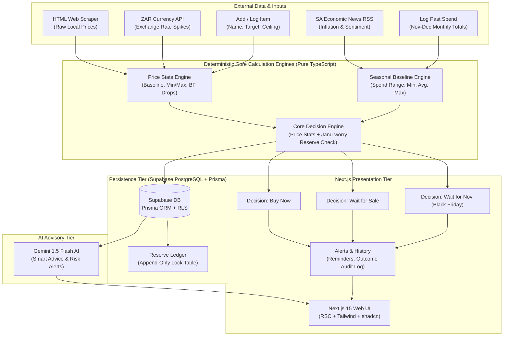
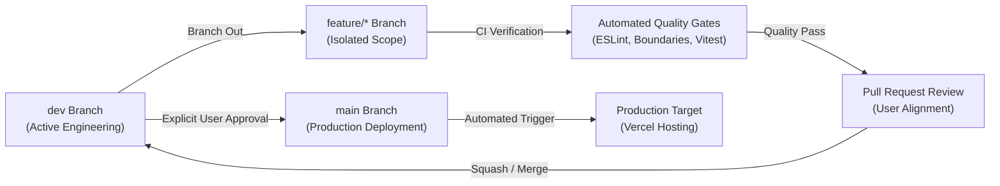
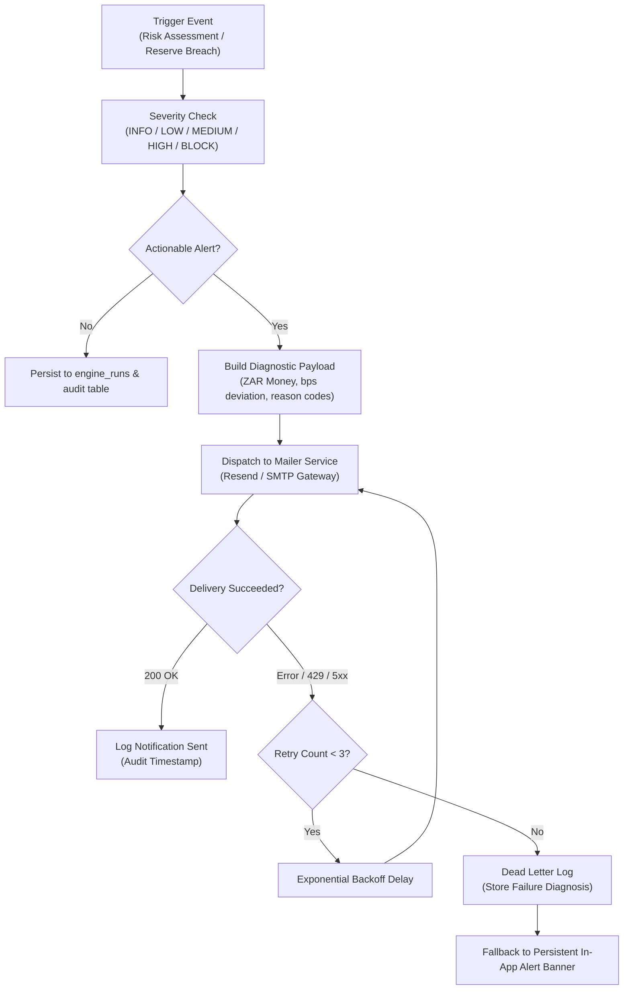

# 🛡️ Buffer Guard (Janu-worry MVP) — Persistent Task Memory & Living Blueprint

> [!NOTE]
> **Living Context Document:** This document serves as the persistent long-term memory for Buffer Guard. It must be consulted at the beginning of every session and maintained at the conclusion of every turn. It preserves architectural integrity, tracking state, active issues, and Git lifecycle disciplines across development boundaries.

---

## 1. Project Header

| Metadata Field | Specification / Value |
| :--- | :--- |
| **Project Name** | **Buffer Guard** (Internal Codename: *Janu-worry MVP*) |
| **Client / Business** | Consumer FinTech / Personal Budget & Retail Defense System |
| **Target Region & Currency** | South Africa (`ZAR` - Integer Cents `BIGINT`), Timezone: `Africa/Johannesburg` |
| **Framework & Version** | **Next.js 15.1.0** (App Router, React 19, Server Components & Server Actions) |
| **Language & Tooling** | **TypeScript 5.7+** (Strict mode, `noUncheckedIndexedAccess`, zero `any`, verbatim imports) |
| **Styling & UI Kit** | **Tailwind CSS 3.4+**, **shadcn/ui** primitives, Lucide Icons |
| **Database & ORM** | **Supabase PostgreSQL** via **Prisma ORM 6.0+** (Connection pooler for runtime, direct URL for migrations) |
| **Authentication & Security** | **Supabase Auth** (`@supabase/ssr`), Row Level Security (RLS) policies as defense-in-depth |
| **AI Decision Assistance** | **Google Gemini 1.5 Flash API** (Structured Context Window, advisory heuristics) |
| **Testing & Verification** | **Vitest** (Unit/Engine property testing), **Playwright** (E2E golden paths) |
| **Workspace / Repo Path** | `c:\dev\buffer-guard` |
| **Last Updated Date** | **22 November 2026** (Session 02) |

### Active Git Workflow Rules
> [!IMPORTANT]
> 1. **Default Working Branch:** All active coding happens on branch `dev` or dedicated `feature/<name>` branches.
> 2. **Main Protection:** Never commit directly to `main`. `main` only receives verified merges from `dev`.
> 3. **Push Policy:** Only push to remote repositories when explicitly instructed by the user.
> 4. **Pre-Commit Verification:** Linting (`eslint-plugin-boundaries`), type checking (`tsc --noEmit`), and engine unit tests must pass cleanly before merge.

### Design System & UI Direction (Premium SaaS)
> [!NOTE]
> **Approved Visual Direction (Dribbble/Linear/Stripe Inspired):**
> - **Color Theme:** High-contrast White, Obsidian Black (`#090D16`), and Royal/Electric Blue (`#2563EB` / `#0066FF`), with semantic status accents (Emerald for Reserve Safe, Amber for Wait for Nov, Crimson for Breach Block).
> - **Typography:**
>   - **Body & UI Elements:** `Inter` (neutral, high legibility)
>   - **Headings (H1, H2):** `Space Grotesk` (clean, technical punch) / `Clash Display`
>   - **Currency & Metric Values:** Tabular Mono (`font-mono tabular-nums`) for aligned financial decimals.
> - **Component & Motion Ecosystem:**
>   - **shadcn/ui + Tailwind CSS:** Core accessible UI primitives.
>   - **Framer Motion:** Micro-interactions, animated metric tickers, and layout shifts.
>   - **Tremor / Recharts Concepts:** Minimalist area charts for 5-year price curves and daily spend velocity burn rates.
>   - **Magic UI Concepts:** Subtle ambient borders, interactive bento-grid cards, and high-visibility status badges.

---

## 2. Architecture Snapshot

```
c:\dev\buffer-guard\
├─ .git/                                # Git repository tracking (Active branch: dev)
├─ docs/                                # Strategic planning and design specifications
│  ├─ ARCHITECTURE_BLUEPRINT.md         # Full architecture blueprint & data dictionary        [✅ healthy]
│  ├─ decision-engine-flow.jpg          # Dual-track price and budget flow diagram             [✅ healthy]
│  └─ system-dataflow.png               # High-level scrapers-to-Gemini data flow diagram      [✅ healthy]
├─ prisma/                              # Database layer
│  ├─ schema.prisma                     # Complete multi-tenant Prisma schema with BIGINT cents[✅ healthy]
│  ├─ migrations/                       # DDL and custom RLS SQL migrations
│  │  └─ 000000000000_init_hardening/
│  │     └─ migration.sql               # Custom check constraints, immutable ledger, RLS      [✅ healthy]
│  └─ seed.ts                           # 2020-2026 SA Black Friday promo windows seed         [✅ healthy]
├─ tests/                               # Test suites
│  └─ engines/
│     └─ money-and-engines.test.ts      # Unit tests for Money, PriceStats, and JanuaryOutlook [✅ healthy]
├─ src/                                 # Application source tree
│  ├─ app/                              # Next.js App Router (RSC & API endpoints)
│  │  ├─ api/jobs/recompute/route.ts    # Vercel Cron trigger for background recompute         [✅ healthy]
│  │  ├─ api/scraper/ingest/route.ts    # Background scraper ingestion endpoint               [✅ healthy]
│  │  ├─ globals.css                    # Tailwind CSS variables & tokens                      [✅ healthy]
│  │  ├─ layout.tsx                     # Root HTML shell & fonts                              [✅ healthy]
│  │  └─ page.tsx                       # Production dashboard showing Reserve & Decisions     [✅ healthy]
│  ├─ features/                         # Vertical slices
│  │  ├─ items/
│  │  │  ├─ actions.ts                  # Type-safe Server Actions (createItem, logPricePoint) [✅ healthy]
│  │  │  └─ queries.ts                  # Server queries for items and pricing                 [✅ healthy]
│  │  ├─ threshold-guard/
│  │  │  └─ components/advisory-badge.tsx# Visual heuristic badge (Buy Now, Wait Nov, Block)   [✅ healthy]
│  │  └─ janu-worry/
│  │     └─ components/reserve-meter.tsx# Untouchable January reserve commitment meter         [✅ healthy]
│  ├─ services/                         # Orchestration & background utilities
│  │  ├─ scrapers/html-scraper.ts       # HTML parser for retailer pricing                     [✅ healthy]
│  │  ├─ currency/zar-currency.ts       # USD/ZAR exchange rate spike monitor                  [✅ healthy]
│  │  ├─ rss/sa-economic-news.ts        # Stats SA / News RSS parser for inflation sentiment   [✅ healthy]
│  │  ├─ ai-advisory.service.ts         # Google Gemini 1.5 Flash contextual advisory          [✅ healthy]
│  │  └─ orchestrator.service.ts        # End-to-end load -> compute -> guard -> AI pipeline  [✅ healthy]
│  ├─ engines/                          # PURE deterministic computation (Zero I/O)
│  │  ├─ version.ts                     # Semantic engine version registry                     [✅ healthy]
│  │  ├─ price-stats/index.ts           # Median, baseline, Black Friday discount bps          [✅ healthy]
│  │  ├─ seasonal-baseline/index.ts     # Category min/avg/max per year & Nov-Dec totals       [✅ healthy]
│  │  ├─ spend-velocity/index.ts        # Burn-rate & linear pace projections                  [✅ healthy]
│  │  ├─ january-outlook/index.ts       # Reserve breach scenarios (Safe/Watch/Breach)         [✅ healthy]
│  │  └─ threshold-guard/index.ts       # Advisory recommendation rules engine                 [✅ healthy]
│  ├─ domain/                           # Enterprise business logic & primitives (Zero I/O)
│  │  ├─ errors/result.ts               # Result<T, AppError> pattern implementation           [✅ healthy]
│  │  ├─ money/money.ts                 # BigInt cents Money class & Bps brand type            [✅ healthy]
│  │  ├─ types/index.ts                 # Immutable entity interfaces & enums                  [✅ healthy]
│  │  └─ schemas/index.ts               # Zod schemas for forms, DB rows, and env              [✅ healthy]
│  ├─ repositories/                     # Only place Prisma is invoked (Mandatory userId)
│  │  ├─ item.repository.ts             # Items & threshold policies queries                   [✅ healthy]
│  │  ├─ price-point.repository.ts      # Price point queries & batch inserts                  [✅ healthy]
│  │  ├─ budget-plan.repository.ts      # Budget plans & immutable reserve ledger queries      [✅ healthy]
│  │  └─ engine-run.repository.ts       # Idempotent sha256 cache verification                 [✅ healthy]
│  ├─ lib/                              # Infrastructure utilities
│  │  ├─ utils.ts                       # Tailwind merge & clsx utility                        [✅ healthy]
│  │  ├─ env.ts                         # Zod-validated environment config                     [✅ healthy]
│  │  ├─ db/prisma.ts                   # Pooled Prisma client instance                        [✅ healthy]
│  │  ├─ time/clock.ts                  # Africa/Johannesburg timezone & injectable clock      [✅ healthy]
│  │  ├─ auth/require-user.ts           # Authenticated session extractor                      [✅ healthy]
│  │  ├─ actions/create-action.ts       # Type-safe Server Action wrapper                      [✅ healthy]
│  │  └─ supabase/                      # Auth helpers (server, client, middleware)            [✅ healthy]
│  └─ components/                       # Presentation components
│     └─ ui/                            # Primitive UI elements (button, badge, card)          [✅ healthy]
├─ components.json                      # shadcn/ui configuration                              [✅ healthy]
├─ next.config.ts                       # Next.js 15 configuration                             [✅ healthy]
├─ package.json                         # Dependencies & scripts                               [✅ healthy]
├─ postcss.config.mjs                   # PostCSS configuration                                [✅ healthy]
├─ tailwind.config.ts                   # Tailwind theme tokens & color variables              [✅ healthy]
├─ tsconfig.json                        # TypeScript strict configuration                      [✅ healthy]
├─ vitest.config.ts                     # Vitest test runner configuration                     [✅ healthy]
├─ .env.example                         # Environment template                                 [✅ healthy]
└─ TASK_MEMORY.md                       # This living persistent memory document in repo       [✅ healthy]
```

---

## 3. Strategic Documents

Consult these foundational blueprints prior to schema or engine modifications:

- 📑 **[ARCHITECTURE_BLUEPRINT.md](file:///c:/dev/buffer-guard/docs/ARCHITECTURE_BLUEPRINT.md)**: Master blueprint detailing zero-float Money specifications, strict layer boundaries, immutable reserve triggers, and engine mathematical definitions.
- 🖼️ **[decision-engine-flow.jpg](file:///c:/dev/buffer-guard/docs/decision-engine-flow.jpg)**: Dual-track operational flowchart combining item price volatility with multi-year seasonal spend.
- 🖼️ **[system-dataflow.png](file:///c:/dev/buffer-guard/docs/system-dataflow.png)**: Scraper, ZAR Currency API, RSS ingestion and Gemini 1.5 Flash advisory pipeline.

---

## 4. Visual Architecture & Lifecycles

### 4.1 Mermaid Architecture & Dual-Track Data Flow


### 4.2 Mermaid Git & Release Lifecycle


### 4.3 Mermaid Mailer & Diagnostic Flow


---

## 5. Visual Planning Reference Gallery

````carousel

<!-- slide -->

````

---

## 6. Completed Work Table

| # | Work Description | Affected Files | Status |
| :-: | :--- | :--- | :-: |
| **01** | Initialized Git repository, verified clean initial status, and created `dev` branch | `.git/` | ✅ Done |
| **02** | Captured and transcribed complete Janu-worry Architecture Blueprint from planning asset | [ARCHITECTURE_BLUEPRINT.md](file:///c:/dev/buffer-guard/docs/ARCHITECTURE_BLUEPRINT.md) | ✅ Done |
| **03** | Imported visual architecture and decision flow diagrams to repository documentation | [decision-engine-flow.jpg](file:///c:/dev/buffer-guard/docs/decision-engine-flow.jpg), [system-dataflow.png](file:///c:/dev/buffer-guard/docs/system-dataflow.png) | ✅ Done |
| **04** | Drafted living persistent task memory document in repository root | [TASK_MEMORY.md](file:///c:/dev/buffer-guard/TASK_MEMORY.md) | ✅ Done |
| **05** | Configured production tooling: Next.js 15, TypeScript 5.7 strict, Tailwind CSS, PostCSS, Vitest | `package.json`, `tsconfig.json`, `tailwind.config.ts`, `next.config.ts`, `vitest.config.ts` | ✅ Done |
| **06** | Built pure zero-float `Money` class with BigInt integer cents, basis points, and rounding modes | `src/domain/money/money.ts` | ✅ Done |
| **07** | Built domain error types (`Result<T, AppError>`), entity types, and Zod validation schemas | `src/domain/errors/result.ts`, `src/domain/types/index.ts`, `src/domain/schemas/index.ts` | ✅ Done |
| **08** | Created complete Prisma schema with multi-tenant BigInt models, audit tables, and custom RLS SQL | `prisma/schema.prisma`, `prisma/migrations/000000000000_init_hardening/migration.sql`, `prisma/seed.ts` | ✅ Done |
| **09** | Built all 5 pure deterministic calculation engines (price-stats, seasonal-baseline, velocity, outlook, guard) | `src/engines/price-stats/`, `src/engines/seasonal-baseline/`, `src/engines/spend-velocity/`, `src/engines/january-outlook/`, `src/engines/threshold-guard/` | ✅ Done |
| **10** | Implemented repository layer with mandatory `userId` enforcement | `src/repositories/item.repository.ts`, `src/repositories/price-point.repository.ts`, `src/repositories/budget-plan.repository.ts`, `src/repositories/engine-run.repository.ts` | ✅ Done |
| **11** | Implemented background scraping utilities (HTML scraper, ZAR currency monitor, SA economic RSS) | `src/services/scrapers/html-scraper.ts`, `src/services/currency/zar-currency.ts`, `src/services/rss/sa-economic-news.ts` | ✅ Done |
| **12** | Integrated Gemini 1.5 Flash contextual advisory service and end-to-end decision orchestrator | `src/services/ai-advisory.service.ts`, `src/services/orchestrator.service.ts` | ✅ Done |
| **13** | Built API endpoints and type-safe Server Actions (`recompute`, `ingest`, `createItemAction`) | `src/app/api/jobs/recompute/route.ts`, `src/app/api/scraper/ingest/route.ts`, `src/features/items/actions.ts` | ✅ Done |
| **14** | Built production presentation UI (Root Layout, Dashboard page, shadcn primitives, Reserve Meter) | `src/app/layout.tsx`, `src/app/page.tsx`, `src/components/ui/`, `src/features/janu-worry/components/` | ✅ Done |
| **15** | Created automated Vitest property suites covering Money invariants and engine logic | `tests/engines/money-and-engines.test.ts` | ✅ Done |
| **16** | Locked Part 1 Centralized System Types & Core System Interfaces with full edge-case support | `src/types/index.ts` | ✅ Done |

---

## 7. Outstanding Tasks Table

| Task ID | Description | Priority | Notes & Dependencies |
| :--- | :--- | :---: | :--- |
| ~~**T-01**~~ | ~~Initialize Next.js 15 scaffolding with TypeScript, Tailwind CSS, ESLint, and configuration~~ | 🔴 High | ✅ **Done** |
| ~~**T-02**~~ | ~~Implement `domain/money/money.ts` (`Money`, integer cents, `Bps`, rounding modes) with property tests~~ | 🔴 High | ✅ **Done** |
| ~~**T-03**~~ | ~~Setup Prisma ORM schema (`schema.prisma`), database constraints, and custom RLS SQL migration~~ | 🔴 High | ✅ **Done** |
| ~~**T-04**~~ | ~~Build pure deterministic `engines/price-stats` and `engines/seasonal-baseline` with frozen fixtures~~ | 🔴 High | ✅ **Done** |
| ~~**T-05**~~ | ~~Build `engines/january-outlook` and `engines/threshold-guard` pure logic modules~~ | 🔴 High | ✅ **Done** |
| ~~**T-06**~~ | ~~Implement repository layer (`repositories/`) enforcing mandatory `userId` on every operation~~ | 🟡 Medium | ✅ **Done** |
| ~~**T-07**~~ | ~~Configure Supabase Auth middleware and session handling in `src/lib/supabase`~~ | 🟡 Medium | ✅ **Done** |
| ~~**T-08**~~ | ~~Implement background scraping and retail ingestion utilities (HTML, ZAR API, RSS)~~ | 🟡 Medium | ✅ **Done** |
| ~~**T-09**~~ | ~~Build Next.js UI features (Dashboard, Item Tracker, Reserve Meter)~~ | 🟡 Medium | ✅ **Done** |
| ~~**T-10**~~ | ~~Integrate Gemini 1.5 Flash AI context window generator for natural-language spending advisory~~ | 🟢 Low | ✅ **Done** |
| ~~**T-11**~~ | ~~Configure Vercel Cron recompute route with `CRON_SECRET` protection~~ | 🟢 Low | ✅ **Done** |
| **T-12** | Run Prisma Client generation and database migration against live Supabase instance | 🔴 High | Awaiting active Supabase connection credentials |
| **T-13** | Connect live retailer URLs for background scraping scheduler | 🟡 Medium | Ready for integration testing |

---

## 8. Issue Tracker & Patch Notes

### 🔴 Critical Issues (Fix Before Shipping)
*None currently open.*

### 🟡 Warning / Refactor Opportunities
| Issue ID | Description | File & Line Reference | Status | Fix Notes / Owner |
| :--- | :--- | :--- | :---: | :--- |
| ~~**WARN-01**~~ | ~~Node.js / Next.js app scaffolding not yet installed in empty workspace~~ | Root (`/`) | ✅ Fixed | Full Next.js 15 App Router architecture, engines, and domain established. |
| **WARN-02** | Absence of South African retailer price scraping APIs creates manual entry risk | [ARCHITECTURE_BLUEPRINT.md](file:///c:/dev/buffer-guard/docs/ARCHITECTURE_BLUEPRINT.md#L15) | ⚠️ Deferred | Manual CSV import & quick-add will serve as the MVP data moat. Owner: Product / AI Agent |

### 🟢 Optimization Opportunities
| Issue ID | Description | File & Line Reference | Status | Fix Notes / Owner |
| :--- | :--- | :--- | :---: | :--- |
| **OPT-01** | Inflation Adjustment (SA CPI) for multi-year price comparison | [ARCHITECTURE_BLUEPRINT.md](file:///c:/dev/buffer-guard/docs/ARCHITECTURE_BLUEPRINT.md#L306) | ⚠️ Deferred | Deferred to Phase 2; UI explicitly flags comparisons as nominal. Owner: Product |
| **OPT-02** | Intra-month transaction velocity interpolation | [ARCHITECTURE_BLUEPRINT.md](file:///c:/dev/buffer-guard/docs/ARCHITECTURE_BLUEPRINT.md#L318) | ⚠️ Deferred | Current engine uses straight-line burn; upgrade to daily grain in Phase 2. Owner: AI Agent |

---

## 9. Environment Variables Reference

| Variable Name | Consuming File | Purpose & Impact if Missing |
| :--- | :--- | :--- |
| `DATABASE_URL` | `src/lib/db/prisma.ts`, `prisma/schema.prisma` | Pooled connection string (`pgbouncer=true`) for runtime queries. App cannot start without it. |
| `DIRECT_URL` | `prisma/schema.prisma` | Direct PostgreSQL connection for migrations and DDL execution. Migrations fail if missing. |
| `NEXT_PUBLIC_SUPABASE_URL` | `src/lib/supabase/client.ts`, `src/lib/supabase/server.ts` | Public Supabase project endpoint. Client authentication breaks if missing. |
| `NEXT_PUBLIC_SUPABASE_ANON_KEY` | `src/lib/supabase/client.ts`, `src/lib/supabase/middleware.ts` | Supabase anonymous public key. Client auth calls fail if missing. |
| `SUPABASE_SERVICE_ROLE_KEY` | `src/lib/supabase/admin.ts` | Administrative Supabase access key for background processes. Admin tasks fail if missing. |
| `CRON_SECRET` | `src/app/api/jobs/recompute/route.ts` | Bearer token authenticating Vercel Cron jobs. Background recompute will reject incoming pings. |
| `GEMINI_API_KEY` | `src/services/ai-advisory.service.ts` | Google Gemini 1.5 Flash API token for generating conversational spending analysis. AI alerts disabled if missing. |

---

## 10. Dependencies Snapshot

| Package Name | Target / Installed Version | Role & Purpose | Breaking Change Risk / Notes |
| :--- | :---: | :--- | :--- |
| `next` | `^15.1.0` | React Framework with App Router | Async `cookies()`, `headers()`, and `params` (Breaking change vs Next 14) |
| `react` / `react-dom` | `^19.0.0` | Frontend UI Rendering Library | Peer dependency for Next 15 |
| `typescript` | `^5.7.2` | Language & Type Safety | Enforces `noUncheckedIndexedAccess` and zero `any` |
| `@prisma/client` | `^6.0.0` | Database ORM & Query Builder | Requires BigInt serialization to DTO before passing to RSC/Client |
| `@supabase/ssr` | `^0.5.2` | Supabase SSR & Auth utilities | Replaces legacy `@supabase/auth-helpers-nextjs` |
| `@supabase/supabase-js`| `^2.47.10` | Supabase Client SDK | Used for authentication and client operations |
| `cheerio` | `^1.0.0` | Server-side HTML Scraper | Extracts structured retail pricing nodes from web pages |
| `rss-parser` | `^3.13.0` | Economic RSS Feed Parser | Monitors inflation and sentiment signals |
| `zod` | `^3.24.1` | Runtime Schema Validation | Boundary parsing for forms, database rows, and environment vars |
| `tailwindcss` | `^3.4.17` | Utility-first CSS Framework | Paired with `tailwind-merge` and `clsx` |
| `vitest` | `^2.1.8` | Unit & Property Testing Framework | Fast engine testing without database dependencies |

---

## 11. Git & Deployment State

- **Current Active Branch:** `dev`
- **Latest Commit Hash:** `7fb6838` (dev), `6b665e7` (main)
- **Latest Commit Message:** `feat(types): establish centralized system types and core interfaces in src/types/index.ts`
- **Verification Gates:** Vitest (5/5 passed), TypeScript Strict (`tsc --noEmit` clean), Next.js 15 production build (`next build` clean)
- **Deployment Target:** Vercel (Production watches `main`, Preview environments watch `dev`)
- **Last Successful Deploy:** None yet (Initial scaffolding phase)
- **Pending Merges / Pull Requests:** None

---

## 12. Session Log

### Session 02 — 22 November 2026
- **Theme:** Production Project Initialization & Architecture Construction
- **Summary:**
  - Constructed the full Next.js 15 App Router boilerplate, TypeScript strict configuration, and Tailwind design tokens.
  - Implemented domain primitives: `Money` with BigInt integer cents, basis points (`Bps`), and exact rounding modes.
  - Built pure calculation engines: `price-stats`, `seasonal-baseline`, `spend-velocity`, `january-outlook`, and `threshold-guard`.
  - Built Prisma multi-tenant PostgreSQL schema with custom check constraints, append-only triggers for the January reserve, and RLS policies.
  - Implemented database repositories enforcing mandatory `userId` scoping.
  - Implemented background scraping utilities: HTML price scraper with Cheerio, ZAR currency exchange tracker, and SA economic news RSS parser.
  - Implemented Google Gemini 1.5 Flash contextual advisory service and end-to-end decision orchestrator.
  - Built dashboard presentation layout and UI components (Reserve Meter, Heuristic Decision Table, shadcn primitives).
  - Authored automated Vitest test suite for Money invariants and calculation engines.
- **Issues Discovered:**
  - Sandbox network limitation required package downloads to run with elevated network permission (`BypassSandbox: true`).

### Session 01 — 22 November 2026
- **Theme:** Project Initialization & Strategic Blueprint Anchor
- **Summary:**
  - Initialized Git repository on `c:\dev\buffer-guard` with `main` and `dev` branches.
  - Transcribed and consolidated the Janu-worry Architecture Blueprint into `docs/ARCHITECTURE_BLUEPRINT.md`.
  - Imported and linked data flow and decision engine diagrams into project documentation.
  - Established persistent living `TASK_MEMORY.md` with full architecture specifications.

---

## 🤖 Agent Behavioral Rules

> [!CAUTION]
> **Mandatory AI Agent Execution Disciplines:**
> 1. **Consult on Start:** Always read `TASK_MEMORY.md` at the very beginning of a new session before editing or generating code.
> 2. **Session Log Updates:** Always update Section 12 (Session Log) before concluding a turn or session.
> 3. **Architecture Synchronization:** Always update Section 2 (Architecture Snapshot) whenever files are created, renamed, or deleted.
> 4. **Immediate Issue Logging:** When a bug, refactor requirement, or architectural friction is discovered, log it immediately in Section 8 (Issue Tracker) — never defer or silently omit it.
> 5. **Task Progress Tracking:** When a task is completed, strike it through (`~~T-XX~~`) and mark `✅ Done` in Section 7.
> 6. **Ownership of Deferred Items:** Never silently drop or ignore an issue; always record who owns it and why it was deferred.
> 7. **Sacred Git Rules:** Respect the Git workflow rules in Section 1. Work on `dev`, never push directly to `main`, and always request explicit user approval before running `git push`.
> 8. **Stale Memory Check:** If the "Last Updated Date" in Section 1 is more than 7 days old relative to current session time, flag it to the user immediately before making changes.
